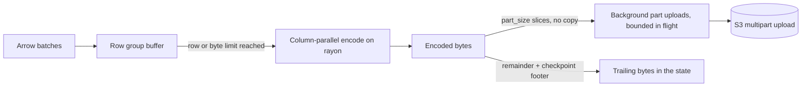
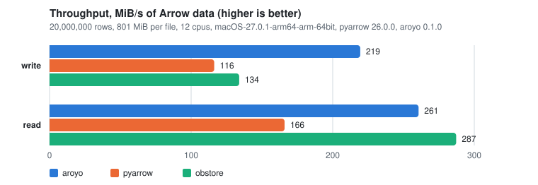

# aroyo

**Crash-resumable Parquet streaming to S3 from Python.** One multipart upload per
file, a checkpoint any process can finish, and parallel reads back. Rust core, PyO3
bindings, Arrow in and out without copies.

[](https://github.com/4thel00z/aroyo-python/actions/workflows/ci.yml)
[](https://github.com/4thel00z/aroyo-python/actions/workflows/release.yml)
[](https://pypi.org/project/aroyo/)
[](https://pypi.org/project/aroyo/)
[](#license)

```python
writer = aroyo.ParquetStreamWriter(config, "events/2026-10-28.parquet", batch.schema)
writer.write(batch)
state = writer.checkpoint()        # small, serializable, survives the process
...                                # the process dies here
aroyo.finish(config, state)        # any other process: a valid Parquet file, no re-upload
```

## Why

S3 objects cannot be appended to, and a streaming job that writes one file across
many checkpoints has to keep a multipart upload open. Existing Python writers
(pyarrow's `S3FileSystem`, obstore) stream a multipart upload but cannot resume one:
when the process dies, the file is gone. aroyo implements the method from Arroyo's
filesystem sink ([Streaming to S3 is hard](https://www.arroyo.dev/blog/streaming-to-s3-is-hard/))
so that a checkpoint carries enough to complete the file later, from anywhere, with
nothing already uploaded sent again. It needs no conditional writes, so it works on
S3-compatible stores that accept and ignore `If-Match`.

| | streams a multipart upload | resumes after a crash | parallel reads |
|---|---|---|---|
| pyarrow `S3FileSystem` | yes | no | no |
| obstore | yes | no | partially |
| **aroyo** | **yes** | **yes** | **yes** |

## Install

```sh
pip install aroyo
```

Python 3.12 or newer. Wheels ship for Linux (x86_64, aarch64), macOS (arm64, x86_64)
and Windows. Building from source needs a Rust toolchain and maturin.

## How it works

### Write path



Batches are buffered until a row group is full. Every leaf column is then encoded on
its own rayon task, the encoded bytes are sliced into fixed-size parts without
copying, and the parts upload on a tokio runtime while the next row group is
encoded. The GIL is released around every network call.

### Checkpoint and recovery

```mermaid
sequenceDiagram
    participant W as Writer (process A)
    participant S as S3
    participant F as finish (process B)
    W->>S: CreateMultipartUpload
    W->>S: UploadPart 1..n (background, bounded)
    W->>W: checkpoint(): close row group, wait for parts in flight, build footer
    Note over W: state = upload id + parts + trailing bytes (unsent bytes + footer)
    W--xW: process dies
    F->>S: UploadPart n+1.. (trailing bytes)
    F->>S: CompleteMultipartUpload(parts 1..n+1)
    Note over F,S: on failure: HEAD; an object of the expected size means success
```

`checkpoint()` returns a `WriterState`: the parts acknowledged so far and the
*trailing bytes*, which are the bytes not yet uploaded plus a Parquet footer for
the row groups written so far. `finish(config, state)` uploads the trailing bytes
as the last part(s) and completes the upload. The result is a valid Parquet file
holding every row up to that checkpoint. Calling it twice is safe.

`close()` writes the real footer as the last part and returns a `PendingCommit`;
`commit()` completes the upload. That split is the second phase of a two-phase
commit: record the pending state durably first, then commit.

### Read path

`read_parquet` reads the footer with one range request, then fetches `concurrency`
row groups ahead of the consumer with coalesced range GETs, decodes them on the
blocking pool and hands batches to Python through the Arrow C stream interface, in
file order.

## Quickstart

```python
import pyarrow as pa
import aroyo

config = aroyo.S3Config.from_env(bucket="events")   # AWS_ENDPOINT, AWS_ACCESS_KEY_ID, ...

writer = aroyo.ParquetStreamWriter(
    config,
    "events/part-0001.parquet",
    schema,                            # anything with __arrow_c_schema__
    part_size=16 * 1024 * 1024,        # 5 MiB .. 5 GiB
    row_group_size=128 * 1024 * 1024,  # buffered Arrow bytes that close a row group
    compression="zstd",
)
writer.write(batch)                    # RecordBatch, Table, RecordBatchReader, polars ...

state = writer.checkpoint()            # closes the row group, waits for parts in flight
blob = state.to_bytes()                # store this with your own checkpoint
writer.write(next_batch)               # same file, same upload

pending = writer.close()               # real footer uploaded, upload not yet completed
record(pending.to_bytes())             # your durable checkpoint
pending.commit()                       # completes the multipart upload

# Another process, after a crash, from the last recorded blob:
aroyo.finish(config, aroyo.WriterState.from_bytes(blob))

reader = aroyo.read_parquet(config, "events/part-0001.parquet", columns=["a", "b"], concurrency=8)
table = pa.RecordBatchReader.from_stream(reader).read_all()
```

`S3Config` pickles, so it can be handed to multiprocessing workers.

## Performance



| | write MiB/s | read MiB/s |
|---|---|---|
| **aroyo** | 219 | 261 |
| pyarrow | 116 | 166 |
| obstore | 134 | 287 |

Apple M3 Pro, 12 cores, 20,000,000 rows (801 MiB of Arrow data) per file, pyarrow 26.0.0, obstore 0.12.1, aroyo 0.1.0. aroyo reads with `concurrency=8`; the obstore baseline reads through pyarrow's own multithreaded decoder.

The benchmark writes and reads one Parquet file of synthetic int64, float64 and
string columns against a local S3-compatible server (RustFS in Docker) with every
library at its defaults. Numbers are the mean of three runs; `make bench` and
`python benchmarks/plot.py` reproduce the chart on your machine.

## Rules for callers

- **One writer per state.** There is no compare-and-set. Stop the old writer before
  `finish(state)` runs in a new process. A writer that is still running can complete
  the upload with a different part list; one of the two wins and the other fails the
  size check with `AroyoError`.
- **Abandoned uploads cost storage.** Configure an `AbortIncompleteMultipartUpload`
  lifecycle rule on the bucket, and call `aroyo.abort(config, state)` or
  `writer.abort()` for uploads you give up on. The writer aborts its upload when a
  `with` block exits with an exception. A writer that is dropped without `close()` or
  `abort()` leaves its upload in place, so a recorded checkpoint stays finishable.
- **Keep files short-lived.** Some providers expire upload IDs after days. Roll files
  by size or time. A file may hold at most 10,000 parts; the writer raises before it
  would send part 10,001.
- Every `checkpoint()` closes a row group, so frequent checkpoints mean small row
  groups.

## API

| | |
|---|---|
| `S3Config(**kwargs)` / `S3Config.from_env(**kwargs)` | bucket, region, endpoint, credentials, `allow_http`, `virtual_hosted_style`. `from_env` reads `AWS_*` first. |
| `ParquetStreamWriter(config, path, schema, **options)` | `write(batches)`, `checkpoint() -> WriterState`, `close() -> PendingCommit`, `abort()`, `rows_written`, `rows_pending`, context manager |
| `WriterState` | `to_bytes()`, `from_bytes()`, `path`, `upload_id`, `parts`, `uploaded_bytes`, `expected_size`, `rows`, `is_pending_commit` |
| `PendingCommit` | `commit()`, `state`, `to_bytes()` |
| `finish(config, state)` | uploads the trailing bytes and completes the upload; idempotent |
| `abort(config, state)` | aborts the upload |
| `read_parquet(config, path, *, columns, concurrency, batch_size)` | returns an Arrow C stream (`pa.RecordBatchReader.from_stream(...)`) |
| `AroyoError` | every storage or format failure; bad arguments raise `ValueError` |

### Writer options

| option | default | meaning |
|---|---|---|
| `part_size` | 16 MiB | bytes per part; every part except the last has exactly this size |
| `row_group_size` | 128 MiB | buffered Arrow bytes that close a row group |
| `max_row_group_rows` | 1,048,576 | rows that close a row group |
| `max_in_flight_parts` | 4 | parts uploading at once before `write` waits |
| `compression` | `"snappy"` | `uncompressed`, `snappy`, `zstd`, `lz4`, `gzip`, `brotli` |

### Reader options

| option | default | meaning |
|---|---|---|
| `columns` | all | top-level columns; returned in file order |
| `concurrency` | 4 | row groups fetched and decoded ahead of the consumer |
| `batch_size` | 65,536 | rows per returned batch |

Memory for a read is about `concurrency` row groups' worth of compressed bytes plus
a couple of decoded batches per row group.

## Design notes

**Footer without a fork.** Arroyo patches `parquet` to write a footer without closing
the writer. aroyo builds the same footer from upstream
`SerializedFileWriter::flushed_row_groups()` with `ParquetMetaDataWriter`. Column
chunk offsets in row-group metadata are absolute file offsets, so the footer is valid
at the current `bytes_written()`. The upstream writer assigns page-index offsets only
in the final footer, so a checkpoint footer carries no page index while a file closed
with `close()` keeps it. Both are valid Parquet; the tests read recovered files back
with the Arrow schema, timezone-aware timestamps and nested columns intact.

**Upload ID access.** `ObjectStore::put_multipart` hides the upload ID, so the crate
uses `object_store::multipart::MultipartStore` on the concrete `AmazonS3`. Stores are
built from `S3Config`; accepting an `obstore` store object is not supported yet.

**State format.** `WriterState.to_bytes()` is a magic prefix, a format version and a
postcard-encoded body. Validation on `from_bytes()` rejects truncated blobs and part
lists with gaps.

**Versions.** `pyo3-arrow` 0.20 pins `arrow` 59, so the crate uses `parquet` 59 and
`object_store` 0.13, one version of each.

## Development

```sh
uv venv && source .venv/bin/activate
uv pip install maturin pytest pyarrow "moto[server]" obstore numpy
make develop     # maturin develop
make ci          # cargo fmt --check, clippy -D warnings, cargo test
make test-py     # pytest against an in-process moto S3
make s3          # RustFS in Docker on 127.0.0.1:9000 (rustfsadmin / rustfsadmin)
```

Set `AROYO_TEST_ENDPOINT`, `AROYO_TEST_BUCKET` and the `AWS_*` variables to run
pytest against RustFS or any other store instead of moto. The benchmark takes
`AROYO_BENCH_ENDPOINT` and `AROYO_BENCH_BUCKET`:

```sh
python benchmarks/bench_throughput.py --rows 20000000 --repeat 3 --json results.json
python benchmarks/plot.py results.json benchmarks/results/throughput.svg
```

## License

MIT OR Apache-2.0. The write method follows Arroyo (MIT OR Apache-2.0).
